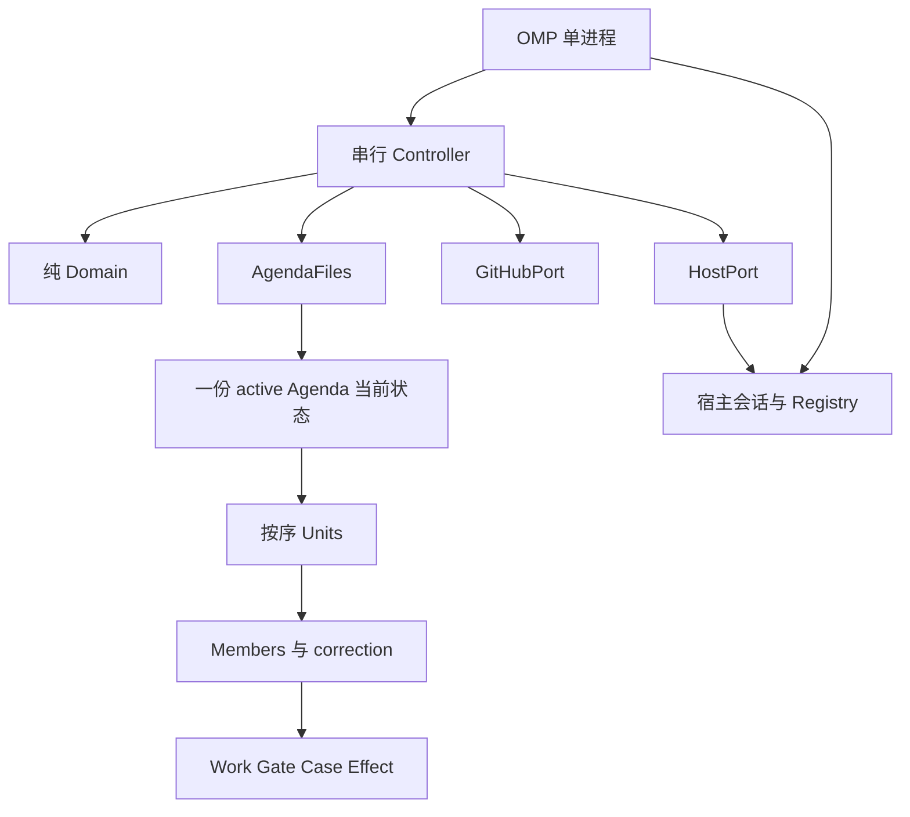
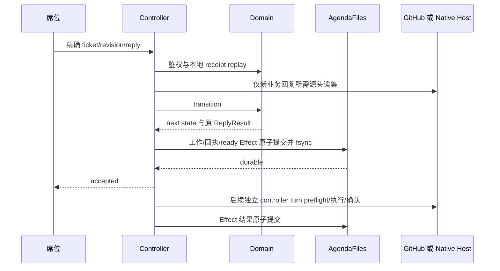

# Roundtable

Roundtable 在一个 OMP 进程内串行交付有序 GitHub issue。它维护本地当前协议对象、接受角色回复、核实源头并执行外部效应；它不把通知当成完成，也不把 GitHub 读数当成本系统接受的声明。

## 依据与要求

产品要求来自 `delivering-issues` 的逐项分类、隔离 owner、fresh review/accept、设计裁定、合并后验收、修正链和 parent 关闭验证。操作员已选择本地当前状态、程序合并和唤醒、仅 `{ok,note}` 的 gate 载荷，以及只在圆桌模式可见的端口。GitHub 只承载交付产物，不保存协议评论、议程 issue、签章或回执。

本系统必须按序交付跨 repo 的 issue；每个成员拥有独立 owner；同成员续作保留目录与未推送提交。每份新 GateJob 使用新 JobId、新隔离 holder；review/accept 分别只在自己的输入戳变化、claim 或明确评判义务替换时重做，不能因 review-only 正文变更重跑仍匹配的 accept。两个独立槽位可以并行；开放 work/case/未确认物化阻止票据执行和 merge，不要求删除仍匹配的历史结果。不同成员不能借 gate 绕过前置、correction 或顶层 unit 串行；correction 及其 correction 都留在原 unit。

本系统必须处理 noCode、split、blocked、question、外国与接管 PR、真实源头变更、checks 重跑、契约修订的 defaultFirst/withPr/future 路线、孤立设计承载、迁移、compact、park、abort 和完整进程重启。Main 自行完成日常裁定，不向操作员询问业务推进。Main 不回答时，义务必须保持可见，系统不承诺模型公平性或必然完成。

## 术语与记录性质

|名称|含义|确认方|
|---|---|---|
|Agenda|一次召集的当前协议状态，含按序 unit、对象槽位、运行绑定与报告|本系统|
|Unit|一个原成员及其前置、修正成员构成的串行交付范围|本系统；其终点需要源头确认和 postMerge|
|Member|一个真实 IssueRef 的交付义务和当前契约|本系统拥有义务；GitHub 拥有 issue|
|OwnerWork / DesignWork|一次开放工作义务；WorkId 稳定，内容版本可变|accepted terminal reply 或明确允许的源头/裁定终点|
|GateJob|一次独立评判，固定 JobId 和结构化输入戳|accepted verdict；不是平台 checks|
|DecisionCase|Main 需要分类的精确问题、已接受决定及直接应用依赖|本系统；应用完成由孩子结果确认|
|Effect|已经持久化的一次外部写意图，不代表写已完成|GitHub 源头或本次 native delivery 返回|
|SeatRequest|使用真实会话的请求和被接受绑定，不是 registry 状态副本|OMP registry/lifecycle|
|Draft / AmendmentIntent|要创建/放置的 issue 与要生效的契约修订意图|真实 issue/挂接、正文与设计 commit|
|FactRead|某次完整源头读取的近处副本，只在进程内存在|GitHub；仅代表取回时刻|
|Ticket|当前对象的职责投影，不是事实或事件日志|由纯函数产生|
|Receipt|本系统已经接受某个精确回复及返回结果的事实|与对应转移一起 durable 写入|

所有 IssueRef/PrRef 都包含 `{repo:{owner,name},number}`。ShaRef 包含 `{repo,sha}`，相同 SHA 字符串不跨 repo 合并责任。Carrier 明确为 member 或 draft，不广播给同 repo 的其它设计项。

## 范围

产品只支持一个进程、一个 active Agenda、一个串行写者。version 比较防止该进程的陈旧写入，不是跨进程原子 CAS；本系统不加 pid 锁、租约或跨进程对账。resume 的旧进程结束确认是受信操作员声明或已经观察的 exit，不是程序证明。

这些协议约束适用于运行中 Agenda 管理的业务 issue、PR、席位和效应。圆桌实现本身的开发、提交、验证和 PR 交付不继承业务对象的 ticket、gate、head 或 checks 生命周期；沙盒对象是功能输入与证据，不是外层交付的外部依赖。

生命周期包含关系及结束锚点在 [lifecycles.md](protocol/lifecycles.md) 定义；模块树不代替生命周期。

## 部件与连接

|部件|拥有|不拥有|
|---|---|---|
|domain|精确对象、纯 transition、tickets、briefs、runtime parser、准入与生命周期规则|时钟、随机、文件、网络、真实 registry|
|ports|GitHub 源头读写、原子文件、native 会话接口和结构化错误|协议判断或第二份业务状态|
|controller|单写者队列、读集、完整缓存、意图执行、确认、恢复、定时器|替 Main/owner/gate 作业务回复|
|extension|真实调用身份、模式、工具激活、context、yield 拦截、Main 提醒|平台状态、模型最终会行动的保证|

## 交互摘要

Main 用 `/roundtable` 打开模式，用 `convene` 检查或召集，用真实原生 async isolated task 完成 spawn 票据。程序不能公开 spawn 时不伪造自动 spawn。owner/gate 只使用 `tickets/reply`；模式外、非 holder、重复多派者及孙级没有端口。执行入口仍核权限，不以工具隐藏代替鉴权。

确定性的 merge/close/reopen/body/create/attach/rerun/wake 都由同一 Effect 生命周期驱动。程序向 runnable 且 native idle（非 streaming）或 parked 的 holder 投递，每个内容版本自动投递一次。Main 只在真实异常/业务分类时裁定；native relay 或子席位自述不构成协议回复。

## 阅读次序

- [协议对象与决定](protocol/README.md)：当前状态、纯 API、回复与职责。
- [生命周期](protocol/lifecycles.md)：包含、终点、hold、失败、中断和恢复。
- [集成契约](integration/README.md)：九项连接、完整接口、源头读集与宿主边界。
- [验收](acceptance.md)：R01–R13、真实功能路径、恢复与持续运行条件。
- [证据](evidence.md)：已核验的宿主/GitHub 性质及未验证范围；此文件不增加规则。
