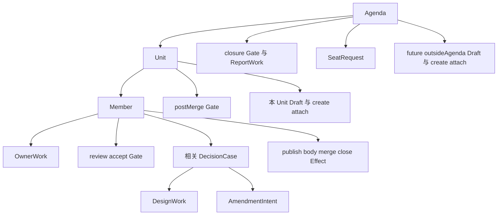
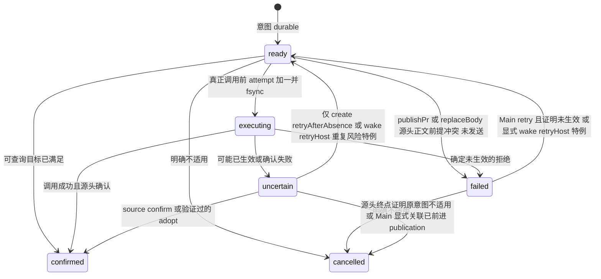

# 生命周期、失败与中断

本文展开协议对象的开始、结束、包含关系及确认者。它不把外部当前读数持久化为本系统真相；源头动作完成判据在 [集成动作表](../integration/README.md#c4-统一动作执行) 定义。

## 包含与结束锚点

|对象|开始锚点|结束锚点与确认方|
|---|---|---|
|Agenda|execute convene 完整校验后 durable 创建|所有内层终点、parent closure/关闭、全部效应终结、Main report receipt 同次 durable 后 completed|
|Unit|召集或接受 insertion 建立|全部成员终点/关闭对账/内层终结，覆盖全成员 fresh postMerge 通过；全 noCode 也有独立 fresh job/holder，覆盖 noCode hash/reason、契约与关闭状态|
|Member|真实 IssueRef 进入 unit|真实 merge 或当前有效 noCode，必要关闭及其工作/case/效应已终结|
|OwnerWork|源头或接受决定一次转移创建|accepted submit、明确 noCode/replacePr/sourceRestored 决定或真实外部 merge|
|DesignWork|接受 upholdMain/designGap 建立|依赖解除后，真实远端 ShaRef 源头验证并接受 designCommit；本人未决 claim 不得绕过|
|GateJob|输入完整且无阻塞时建立新 JobId|接受 verdict 或明确 cancelled；失败有独立 case 继续负责|
|DecisionCase|精确源头事件、claim、not-ok 或运维失败|无需孩子的合法决定可同次 resolved；有孩子仅全部成功；或固定闭合取消理由|
|Effect|接受回复或 observe 建立 durable 意图|源头/宿主确认或精确合法取消；失败/未知/等待均非终点|
|Draft|接受决定分配 DraftId|outsideAgenda 实际登记/挂接完成；其余真实 issue、必要 attach 后 placed|
|AmendmentIntent|接受契约变更决定|所有正文 target、设计 commit、转交真实对象满足后一次 effective|
|SeatRequest|真实角色使用意图建立|不再需要且旧投递已确认/合法取消；owner 可跨已结束 Work 存续|
|ReportWork|全部交付结果成立|Main report summary/receipt durable；completed 文件永久保留|

publish/body/edit 属于 Member，不嵌套于已经由 submit 结束的 OwnerWork。内层先结束再写外层终点；不能把 applying Case 暂时清空 required 来绕过孩子。Draft 创建与挂接分属两个 Effect；create 成功并不证明 attach 成功。

## 串行范围与前置/修正

当前 unit 是第一份尚未满足全成员终点、关闭对账与 postMerge 的 unit，不能跳过。当前 unit 的 before 插入其成员序列，原工作添加 dependency{member}，撤销原 gate，前置终点后恢复同一 WorkId。前置终点是该成员 merge/noCode、必要关闭及内层工作/效应结束，不要求整个 unit postMerge。全部成员结束后才起 unit postMerge。

插入未来 unit 的 before/after 是顶层排序；不得插到已终结 unit 之前。correction 永远属于原 unit，包含 correction 的 correction。新增修正撤销原 unit pass，新 postMerge 覆盖完整身份、terminal kind/PR/merge 集合，noCode correction 也改变该戳。
split/Amendment 接受时保存完整原决定，并按输入顺序记录全部 existing Entry/Position 意图和 DraftId；Case 只直接等待一个 Amendment。existing 意图尚不是 Member，Draft 独立登记/挂接后可以保持 registered。所有正文 target、设计、create/attach prerequisites 满足后，同一转移按稳定 UnitId 分组、按接受顺序整组 placement、为每个 before 成员向全部 downstream 开放工作添加 dependency，撤销受影响 gate/未发送 merge，并使 Amendment effective。部分孩子成功不会提前插入或重排议程；outsideAgenda 只登记/挂接，不制造 Member。所有失败/未知孩子保留自身恢复入口与已确认结果。
既有 IssueRef 的插入若尚未在 parent.children 中，先 durable 建立 attachChild：owner 为 draft{draftId} 或 insertion{caseId,exact existing Entry/Position}。必要挂接确认前不出现 Member；同一已排队身份不能被另一个 case/Amendment 占用。parent 独立发现该 child 后也不重复插入；source-confirmed placement 完成才解除原决定。

active Agenda 中早期 unit 被 source reopen 时，先记录 reopened case，撤销后续 gate/未发送 merge。后续已有开放 work 添加精确 dependency hold，不丢工单；没有 work 的 accepted submission 不制造空修复工作，前序依赖只抑制其 gate/merge。前序结束后重新 fresh gate。merge 前提含所有前序 unit 终点与 close/reopen/noCode 基准，不能只看当前 PR。

closure 修原实现的补项回原 unit；其它补项是 closure 前的新顶层 unit。closure-time correction 重新打开早期 unit 时，不自动撤销不受影响的后续 unit postMerge，最终 fresh closure 核实包含新修正的 default ancestry 和整合结果。

## Hold 与内容版本

work 保存依赖意图，availability 仅根据引用对象的当前结果确定。case 要 resolved/cancelled，amendment 要 effective，dependency 要精确成员终点，effect hold 要 confirmed/cancelled；后者只等待一次动作生命周期结束，不能代替 enclosing ApplyingRef 的成功。未完成 publication 的 ready/executing/uncertain 意图使新 owner 修复工作保持 effect hold，避免另一 submit 越过未知写。产生阻塞对象、依赖边与必要 gate 撤销一次转移完成；任何其它未结束 hold 仍阻塞。

一次转移从 held 变 runnable 时 contentVersion 加一，brief 包含最后解除依据；该次已因契约/明确 answer 增长则不重复加。相同内容版本自动投递一次，不建 resumeSerial，不按 parked epoch 增长版本。仍 held 不投递。已满足引用可保留到 work 终点，便于恢复完整依据；清理对象前解除全部引用并保留其仍需承担的 terminal result/receipt。

DesignWork 不等待其 applying 父 case，amendment 只等待设计/正文/draft；Effect 不等待自己的 failure case。case 等孩子，孩子不反过来等 case。

## Case 结束与等待

applying.required 只含直接孩子。成功判据分别是源头验证且被接受的 design commit、effective amendment、outsideAgenda 已登记并挂接或其它 draft placed、confirmed Effect。failed、uncertain 和普通 cancelled 不算成功。recovery 更换引用必须连同 recovery receipt、新对象创建一次原子写；同 EffectId retry 不改引用。

原事实消失仅能以 `externallyMerged|sourceEventSuperseded|parentRemoved|gateCancelledBeforeReply` 取消 case。已接受 not-ok、未承载 commit 和 owner 工作不能用这些理由消失。整个已接受决定失去适用性才允许固定原因终止；不得 Main 再分类覆盖 applying。

SourceCondition 只有 checksSettled{pr,runId}、bodyChanged{issue,fromHash}、commitLanded{commit}、issueState{issue,open}、prChanged{pr,fromHead}、mainRelease{reason}。前五类源头成立使 case reopen、revision 加一；Main 必须新 brief 再决定。mainRelease 无超时。effect 自己 condition 成立只清 wait/重新开放 failure case，不把未知/失败改 ready。

## 效应失败与显式恢复

EffectWait 是 source{condition} 或 rateLimitReset{resetAt}，不抹掉 failed/uncertain。rateLimited 必须有可用源头 Retry-After/适用 reset；resetAt 只是最早允许查询，不是成功或 mutation 授权。无可用 metadata 的 secondary throttle 为 unavailable，保留消敏原因，不编时间。timer/registry/yield 不重发失败 mutation。普通 retry 仅限 failed 且源头证明旧 attempt 未生效；uncertain 先 confirm/adopt/cancel，不能把明确的 create retryAfterAbsence / wake retryHost 重复风险特例推广到其它动作。
failed/uncertain 保留真实调用的 startedAt 与 create/publish 实际返回的 identity（若有）；knownFailed 不同时声称返回 created identity。Main retry/rebase/显式重复风险授权在 ready 保存接受 CaseId、acceptedAt 和上一 attempt 的 error/wait/received provenance；新投递引用原 confirmed delivery。ready 不抹去恢复依据，也不构造第二份外部当前状态。明确失败后若目标已被外部完成，Main retry 可以接受，随后只能 effectSatisfied，不能 effectStarted 或再次 mutation。

取消 reason 仅为 preconditionChanged、targetBecameInapplicable、superseded、holderAbsent、sourceAlreadyAdvanced。ready/failed 可取消；executing/uncertain 一般必须由源头证明原意图不再适用且无待确认写入。merge 只在 exact head/target 都匹配的真实 MERGED 时成功；同 PR 不同 head/target 的最终 merge 或 closed-unmerged 只能使旧意图不适用。仅当整个直接运维决定确已过时，才连同其 precise applying EffectRef 取消原 case；取消嵌套 body/create/attach 不会使 Amendment/accepted finding 成功。取消 publication 原子恢复准确 previous 关联及保留 accepted submission/receipt，并开放实际剩余工作；目标已经满足应 effectSatisfied，wake 永不 effectSatisfied。
setIssueState 的 afterEvent 固定执行方向的反向源头事件：open 记录 lastClose，close 记录 lastReopen，包含 null 基准。执行、已有目标确认和过时判断均比较精确 event id，并保留正文 hash 前提；后来的反向事件使旧意图失效，同秒不同事件不能凭时间相等通过。Main 生命周期决定另核 case subject 仍是当前同方向事件；过期的未决 case 由 sourceEventSuperseded 取消，最新源头另开当前 case。noCode 接受时记录已见 lastReopen id，后续新 reopen 按身份识别，不把 GitHub 秒级时间与本地 acceptedAt 比较。

uncertain publish 的唯一附加恢复例外是 Main adoptResult 明确选择当前真实 OPEN PR。必须匹配 head repo/branch、target、实际 branch head、维护授权，且无其它 Member/活跃 publisher 占有；收到过 response identity 时只能选择它。head/title/body 全匹配则普通 confirmed，不造修复工作；已前进则旧 Effect cancelled(sourceAlreadyAdvanced)，以 origin adopted 安装明确关联，旧 AcceptedSubmission/owner terminal receipt 保持不变，同时建 sourceChange OwnerWork，以实际 PR head 为工作起点。新 owner submit 和 publication 确认前不能 gate/merge。此决定显式承担旧未知远端写可能晚到的风险，不声称取消了 GitHub RPC；晚到正文变化仍使 review/preflight 失效。该例外不允许 ready/knownFailed、closed/merged 候选或其它 Action 借此重发。
replacePr 只放弃已登记的 exact PR，不得清除未确认 publication 的关联；先完成该 Effect 的确认或合法恢复，再决定是否替换。既有 PR 的 publication 调用前重新核源头维护授权、准确关联、accepted head 与正文前提。

GitHub 确定失败自动开 effectFailure case。wake 的投递失败/未知仍由 Effect 保存错误，Main 的 hostPrecondition.seatNonresponse 精确引用该 Effect/Request；retryHost 是显式承担重复风险的一次例外，不能当普通自动重试。旧 uncertain wake 未确认或合法取消前不能被新 work 静默覆盖。若已 confirmed 但无回复，retryHost 创建新 EffectId，不复活 confirmed；普通确定失败 retry 可保持同意图 ID 并增加 attempt。当前 run 未知投递不能凭 live 确认；完整旧进程退出后旧 run holder 不存在才取消旧意图、新 binding 续作。

Main 对 failed/uncertain wake 的 retryHost 在同一次转移中保存明确重复风险授权，并使原 Effect 回到 ready；下一次真实调用 attempt 加一。它是 create retryAfterAbsence 之外唯一允许 unknown 再投递的特例，不推广到 merge/rerun/body。confirmed 后无回复的再次投递才创建新 EffectId。idle plan precheck 明确拒绝且未调用 deliver 时记录 knownFailed，直到宿主实际退出 idle plan 才允许 retryHost。

当前内容版本已有 injected 或 woken receipt、没有协议回复，且 HostObservation.turnEnds 含当前 run/holder/该 messageId 的真实 post-delivery agent_end 时，observe 创建精确 hostPrecondition.seatNonresponse case。单纯 parked/idle 或尚未运行的 delivery 队列不证明回合结束；registry status 不能代替该 exact tuple。Main 自己未答只投影 attentionRequired，不递归创建自身不响应 case。
未发送且 attempt 为 0 的 cancelled wake 不占用成功或未知投递的去重槽；临时 source unavailable 解除后，同一当前 gate 仍可获得首次投递。已确认、未知或实际尝试过的投递不能因此遗忘。

已经源头合并的 carrier 不因尚无 default design ancestry 就变成 orphan。其真实 merge 保持终点，所需提交在指定 postMerge/default closure 的包含关系必须另由源头证明；明确 negative 引出实际验收修正。noCode、放弃或 closed-unmerged 使未落地设计失去承载时才走原 orphan/migration 义务，不删除原 ShaRef。

## 崩溃与存储恢复

|窗口|恢复结果|禁止的替代|
|---|---|---|
|work durable 前|无票据|从 GitHub 猜本地义务|
|work durable 后、投递前|同 WorkId/revision|新造工单|
|reply/ready Effect 原子提交后、enqueue 前|重启扫描 ready/executing/uncertain|内存队列当业务真相|
|ready 后|未发送，正常 preflight|伪造 attempt|
|executing 后、发送前|与已发响应丢失不可区分，保守查询/uncertain|直接再 mutation|
|源头成功后、确认前|可查询动作先查；不满足/歧义/失败保留 uncertain|把零候选当没有执行|
|确认 durable 后、RPC 响应丢失|精确 receipt replay 原 ReplyResult|重新 transition/写入|
|native 注册后、Main spawned 前|只回执已发现候选|再次 spawn|
|wake 投递后、确认 durable 前|同进程重试同 confirmation 写；进程退出则 unknown|registry live 当消息已投递|
|rename 成功、目录 fsync 失败|读回固定目标 envelope，相同则补目录 sync；旧版则重写同 envelope；其它完整版本冲突|重跑 transition、增加 ID/version 或重发外部动作|
|损坏/缺失/format 1或2|corruptState/notFound/unsupportedFormat 明确拒绝|迁移、删除、GitHub 重建|

controller 对一个事件只计算一次固定 nextEnvelope；存储失败保留并重试同一写/confirmation，绝不重新调用源头。恢复出的 executing 先 source reconciliation，再处理 ready；wake 不可查询，保持 uncertain。源头可查询目标满足才确认，未知 open merge 不自动重发。

## 中断与结束

owner abort 或新 run 使用新 SeatRequest 续作，保留同成员独立 clone 和未推送提交，不强推；fresh gate 用新目录。新进程不恢复旧 registry 索引或孤立会话。resume 先验证受信旧进程结束声明，再重建本 run 绑定。

shutdown 按 `(agentId,sessionManager)` 清理当前 session 绑定和 timer，不比较新建 ctx object。完成 report 后卸载 active、停 timer、清 child tool activation；completed 文件可精确只读查询和 report replay，不因查询重启 timer。活跃议程拒绝 `/roundtable off`；完成后才允许 off 或新 convene。

未终点且没有 mustRun、ready/executing effect、可核实等待或开放 Main case 时建立精确 stall case。stall 是可见缺陷入口，不是成功、等待白名单或删除义务手段。模型到达真实无出口 stall 必须失败，不能用 Main 最终一定行动的虚构边修复。
